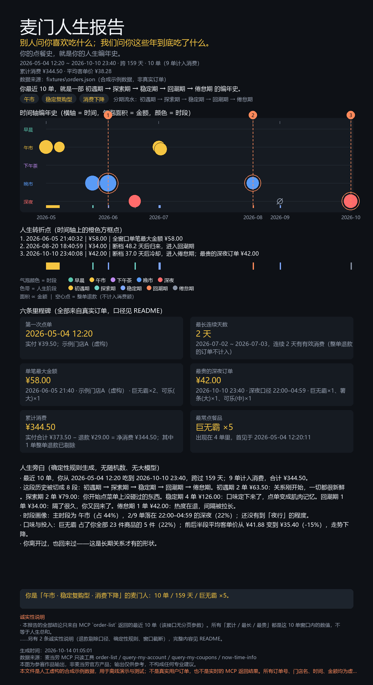

# 麦门人生报告 · mcd-life-report

## 别人问你喜欢吃什么；我们问你这些年到底吃了什么。

**你的点餐史，就是你的人生编年史。**

[](https://www.python.org/)
[](.)
[](.)
[](tests/)
[](LICENSE)
[](https://mcp.mcd.cn)
[](https://github.com/M-China/mcd-developer-innovation-challenge)

> 从麦当劳 MCP 的 `order-list`（真实历史订单）出发，把最近 10 单变成一份**人生编年史**，
> 并生成一张 1200×2200 的可分享长图。**用户什么都不用填** —— 所有结论都从真实订单里长出来。



*上面这张 1200×2200 长图由 `python demo.py` 用仓库内置的**合成示例数据**真实生成（非真实订单）。*

---

## 快速体验（30 秒）

```bash
git clone <本仓库地址> && cd mcd-life-report
python demo.py          # 无需 Token、不联网、零第三方依赖
```

下面这段就是上面这条命令在作者机器上的**真实输出**（数据来自仓库内置的合成示例数据，
所以你可以逐字对照复现；你的机器上只有时间和输出路径会不同）：

```text
==============================================================================
  麦门人生报告 · mcd-life-report
  别人问你喜欢吃什么；我们问你这些年到底吃了什么。
  你的点餐史，就是你的人生编年史。
==============================================================================

[数据来源]
  文件/来源：fixtures\orders.json（合成示例数据，非真实订单）
  合成标记：是（合成示例数据，非真实订单）
  使用工具：order-list / query-my-account / query-my-coupons / now-time-info（只读，不下单、不领券）
  窗口限制：MCP order-list 无分页，最多返回最近 10 单；本次 10 单（窗口已填满，可能被截断）
  说明：本文件是人工虚构的合成示例数据，用于离线演示与测试；不是真实用户订单，也不是实时的 MCP 返回结果。所有订单号、门店名、时间、金额均为虚构。

[窗口概览]
  订单数：10 单（9 单计入消费，1 单整单退款已剔除）
  时间范围：2026-05-04 12:20 ~ 2026-10-10 23:40（跨 159 天）
  累计消费：¥344.50（实付 ¥373.50 − 退款 ¥29.00）
  平均客单价：¥38.28

[人生分期]
  阶段流水：初遇期 → 探索期 → 稳定期 → 回潮期 → 倦怠期
  单数分布：初遇期 2 单、探索期 2 单、稳定期 4 单、回潮期 1 单、倦怠期 1 单
  中位节奏：14.1 天 ｜ 中位客单价：¥34.00 ｜ 探索期信号源：商品品类
  片段：
    1) 初遇期  2026-05-04 ~ 2026-05-11  2 单  ¥63.50
    2) 探索期  2026-05-28  1 单  ¥46.00
    3) 稳定期  2026-06-05  1 单  ¥58.00
    4) 探索期  2026-06-19  1 单  ¥33.00
    5) 稳定期  2026-07-02 ~ 2026-07-03  2 单  ¥68.00
    6) 回潮期  2026-08-20  1 单  ¥34.00
    7) 稳定期  2026-09-03  1 单  ¥0.00
    8) 倦怠期  2026-10-10  1 单  ¥42.00
  逐单判据：
    1. 2026-05-04 12:20:11  初遇期   全部故事的第 1 单，一切从这里开始。（首单）
    2. 2026-05-11 12:35:40  初遇期   距首单 7.0 天（≤ 14 天），仍在初遇期。（距上一单 7.0 天）
    3. 2026-05-28 20:10:05  探索期   首次出现新品类：甜品。（距上一单 17.3 天）
    4. 2026-06-05 21:40:32  稳定期   仍在 汉堡、饮料 里打转，没有引入新品类。（距上一单 8.1 天）
    5. 2026-06-19 23:15:47  探索期   首次出现新品类：咖啡。（距上一单 14.1 天）
    6. 2026-07-02 12:50:18  稳定期   仍在 汉堡、小食 里打转，没有引入新品类。（距上一单 12.6 天）
    7. 2026-07-03 13:05:02  稳定期   仍在 汉堡、饮料、小食 里打转，没有引入新品类。（距上一单 1.0 天）
    8. 2026-08-20 18:40:59  回潮期   距上一单 48.2 天（≥ 30 天），断档一个自然月后又回来了。（距上一单 48.2 天）
    9. 2026-09-03 22:50:26  稳定期   仍在 小食、甜品 里打转，没有引入新品类。（距上一单 14.2 天）
   10. 2026-10-10 23:40:08  倦怠期   距上一单 37.0 天（≥ 30 天），且这是目前最后一单，热度正在冷却。（距上一单 37.0 天）

[六条里程碑]
  第一次点单    2026-05-04 12:20   实付 ¥39.50；示例门店A（虚构）
  最长连续天数   2 天                2026-07-02 ~ 2026-07-03，连续 2 天有有效消费（整单退款的订单不计入）
  单笔最大金额   ¥58.00             2026-06-05 21:40 · 示例门店A（虚构） · 巨无霸×2、可乐(大)×1
  最贵的深夜订单  ¥42.00             2026-10-10 23:40 · 深夜口径 22:00–04:59 · 巨无霸×1、薯条(大)×1、可乐(中)×1
  累计消费     ¥344.50            实付合计 ¥373.50 − 退款 ¥29.00 = 净消费 ¥344.50；其中 1 单整单退款已剔除
  最常点餐品    巨无霸 ×5             出现在 4 单里，首见于 2026-05-04 12:20:11

[人生转折点]
  1. 2026-06-05 21:40:32｜全窗口单笔最大金额 ¥58.00
  2. 2026-08-20 18:40:59｜断档 48.2 天后归来，进入回潮期
  3. 2026-10-10 23:40:08｜断档 37.0 天后冷却，进入倦怠期；最贵的深夜订单 ¥42.00

[人生旁白]
  最近 10 单，你从 2026-05-04 12:20 吃到 2026-10-10 23:40，跨过 159 天；9 单计入消费，合计 ¥344.50。
  这段历史被切成 8 段：初遇期 → 探索期 → 稳定期 → 回潮期 → 倦怠期。初遇期 2 单 ¥63.50：关系刚开始，一切都很新鲜。探索期 2 单 ¥79.00：你开始点菜单上没碰过的东西。稳定期 4 单 ¥126.00：口味定下来了，点单变成肌肉记忆。回潮期 1 单 ¥34.00：隔了很久，你又回来了。倦怠期 1 单 ¥42.00：热度在退，间隔被拉长。
  时段画像：主时段为 午市（占 44%），2/9 单落在 22:00–04:59 的深夜（22%）；还没有到「夜行」的程度。
  口味与投入：巨无霸 占了你全部 23 件商品的 5 件（22%）；前后半段平均客单价从 ¥41.88 变到 ¥35.40（-15%），走势下降。
  你离开过，也回来过——这是长期关系才有的形状。

  ▶ 你是「午市 · 稳定复购型 · 消费下降」的麦门人：10 单 / 159 天 / 巨无霸 ×5。
  标签：午市 · 稳定复购型 · 消费下降

[分享长图]
  期望格式：SVG（Pillow：不可用；中文字体：C:/Windows/Fonts/msyh.ttc）
  已降级输出 SVG：out/mcd-life-report.svg（1200×2200）
    降级原因：未检测到 Pillow（本项目的可选依赖，未安装不影响功能）。已自动降级输出自包含 SVG 长图，尺寸同为 1200×2200，可直接在浏览器或微信中打开与分享。想要 PNG 输出，请执行 `pip install pillow` 后重跑。
  提示：SVG 是自包含矢量长图（1200×2200），浏览器/微信内直接打开即可分享。
  输出文件：out/mcd-life-report.svg

[诚实性说明与已知限制]
  · 本报告的全部结论只来自 MCP `order-list` 返回的最近 10 单（该接口无分页参数）。所有「累计 / 最长 / 最贵」都是这 10 单窗口内的数值，不等于人生总和。
  · 窗口内有 1 单整单退款：它们不计入任何消费额（累计消费、单笔最大金额、最贵深夜单、平均客单价都已剔除），但仍保留在时间轴上并以空心点标记——发生过的事不能被抹掉。
  · 全部旁白由确定性规则从订单数据推出：没有随机数、没有大模型撰写，同一份数据永远得到逐字相同的报告。
  · MCP 的 order-list 无分页参数，只返回最近 10 单：本时间轴是「最近一段」，不是完整消费史。

[口径说明]（全部为确定性规则，详见 README）
  分期·初遇期  第 1 单，以及距首单 ≤ 14 天的订单。 ｜ 理由：半个月是新鲜感的自然观察窗，也是活动与优惠券的常见周转周期。
  分期·探索期  该单带来此前从未出现的新品类（无品类字段时降级为「新商品名首次出现」）。 ｜ 理由：尝新就是探索；引入新品类的时刻比金额更能标记探索行为。
  分期·稳定期  没有引入新品类，且未触发回潮 / 倦怠判据。 ｜ 理由：口味收敛、节奏平稳，是关系进入日常的确定信号。
  分期·倦怠期  ① 断档 ≥ 30 天且此后不再下单；或 ② 间隔 ≥ 14 天且 ≥ 自身中位节奏的 2.0 倍；或 ③ 连续 3 单实付递减且低于中位客单价。 ｜ 理由：绝对断档看自然月，相对降速看用户自己的节奏，金额收缩看投入意愿，三条互为补充。
  分期·回潮期  断档 ≥ 30 天后又回来了（该单之后仍有订单）。 ｜ 理由：冷却后又回来，是比连续消费更值得标注的行为转折。
  里程碑·第一次点单    窗口内时间最早的一单；已退款也算点过，但会标注退款状态。
  里程碑·最长连续天数   日历天连续有有效消费的最长天数；整单退款订单不计入，同日多单只算一天。
  里程碑·单笔最大金额   计入消费订单里净额最大的一单；并列取更早的一单。
  里程碑·最贵的深夜订单  下单时间落在 22:00–04:59 的消费订单里净额最大的一单；并列取更早的一单。
  里程碑·累计消费     净额之和（实付 − 退款）；实付总额与退款总额同时给出，便于核对。
  里程碑·最常点餐品    数量最多；并列依次比较出现订单数、首次出现时间、名称字典序。
  旁白·主时段    计入消费订单按时段计数，占比 ≥ 40% 才指定主时段，否则为「时段分散型」；平局按 早晨→午市→下午茶→晚市→深夜 顺序取胜。
  旁白·夜食指数   深夜（22:00–04:59）订单占比 ≥ 30% 记为夜行倾向，并始终给出真实分子分母。
  旁白·单品依赖度  最常点餐品占全部商品件数比例：≥ 30% 重度依赖型，≥ 15% 稳定复购型，否则广泛探索型。
  旁白·消费走势   按时间对半切比较平均净额，变化 > +15% 记上升，< −15% 记下降，其余为平稳。

==============================================================================
  报告结束。全部结论来自订单数据，由确定性规则推出：无随机数、无大模型撰写。
==============================================================================
```

顺带一提：上面这段输出里出现了一条 **⚠️ 降级提示**。那不是 bug，是本项目对「诚实」
的具体实现——作者的机器上没有装 Pillow，程序就没有假装画出 PNG，而是**明说**自己降级了。

---

## 我们做对了什么别人没做的

| 常见做法 | 我们的做法 |
|---|---|
| 让用户填问卷 / 输入参数来「猜」性格 | **全部结论来自真实订单，零输入**：不填年龄、不填口味偏好，只读 `order-list` |
| 输出「人格标签」或小票风静态卡片 | 输出**时间轴编年史长图**：横轴是时间，每个点是一单，气泡面积=金额、颜色=时段，并**显式标注「人生转折点」** |
| 用大模型现编文案，每次跑出来都不一样 | **确定性规则**推出旁白：同一份数据永远得到逐字相同的报告，可被测试断言 |
| 把整单退款也算进「累计消费」 | **整单退款不计入任何金额指标**（累计、单笔最大、最贵深夜、均价），但保留在时间轴上标成空心点——发生过的事不能被抹掉 |
| 字段缺失就用默认值 / 0 糊过去 | 缺字段就写「**未核实**」并说明为什么；找不到中文字体就宁可不画图，也不输出乱码方块 |
| 「支持 X 个功能」堆一大串，没说清哪些没做 | README 里有**已知限制**一节，把没做和做不到的部分写明白（见文末） |
| 依赖一堆第三方库才能跑起来 | **零第三方依赖**（只用标准库）；Pillow 是可选增强，缺了就自动降级为自包含 SVG |
| 单位含糊（分/元混用） | 金额统一收敛为整数「分」，展示层再 ÷100；换算用 `Decimal` 而不是二进制浮点，不会少算一分钱 |

---

## 一个真实例子（带数字的完整输出）

用仓库内置的合成示例数据跑一趟，得到的是一份「有结论、有依据、有分寸」的报告：

**分期结论**：`初遇期 → 探索期 → 稳定期 → 回潮期 → 倦怠期`（8 个片段，5 个阶段全部出现）

| 片段 | 区间 | 单数 | 净消费 |
|---|---|---|---|
| 初遇期 | 2026-05-04 ~ 2026-05-11 | 2 | ¥63.50 |
| 探索期 | 2026-05-28 | 1 | ¥46.00 |
| 稳定期 | 2026-06-05 | 1 | ¥58.00 |
| 探索期 | 2026-06-19 | 1 | ¥33.00 |
| 稳定期 | 2026-07-02 ~ 2026-07-03 | 2 | ¥68.00 |
| 回潮期 | 2026-08-20 | 1 | ¥34.00 |
| 稳定期 | 2026-09-03 | 1 | ¥0.00 |
| 倦怠期 | 2026-10-10 | 1 | ¥42.00 |

**逐单判据**（每一条都可以被人肉复核）：

- 第 3 单被判为**探索期**，理由是「首次出现新品类：甜品」；
- 第 8 单被判为**回潮期**，理由是「距上一单 48.2 天（≥ 30 天），断档一个自然月后又回来了」；
- 第 10 单被判为**倦怠期**，理由是「距上一单 37.0 天（≥ 30 天），且这是目前最后一单」；
- 第 9 单（¥29.00 整单退款）**净额为 0**，计入消费的 9 单里不含它。

**六条里程碑**：

| 里程碑 | 结果 | 说明 |
|---|---|---|
| 第一次点单 | 2026-05-04 12:20 | 实付 ¥39.50；示例门店A（虚构） |
| 最长连续天数 | 2 天 | 2026-07-02 ~ 2026-07-03，整单退款订单不计入 |
| 单笔最大金额 | ¥58.00 | 2026-06-05 21:40 · 巨无霸×2、可乐(大)×1 |
| 最贵的深夜订单 | ¥42.00 | 2026-10-10 23:40（深夜口径 22:00–04:59） |
| 累计消费 | ¥344.50 | 实付 ¥373.50 − 退款 ¥29.00；1 单整单退款已剔除 |
| 最常点餐品 | 巨无霸 ×5 | 出现在 4 单里，首见于 2026-05-04 |

**人生旁白（节选，全文见上方真实输出）**：

> 你是「**午市 · 稳定复购型 · 消费下降**」的麦门人：10 单 / 159 天 / 巨无霸 ×5。
>
> 你离开过，也回来过——这是长期关系才有的形状。

注意「消费下降 −15%」这个结论的来源：把 9 单计入消费的订单按时间对半切，
前半段平均客单价 ¥41.88、后半段 ¥35.40，实际变化 −15.46%，越过了 −15% 的判据带宽。
**这个数字不是「生成」出来的，是算出来的。**

---

## 核心能力

| 模块 | 能力 | 关键点 |
|---|---|---|
| `src/mcd_adapter.py` | MCP `order-list` 响应适配 | 多候选键字段映射、金额单位换算（分/元，`Decimal` 精确到分）、整单退款过滤、去重、时间排序、**10 单窗口提示** |
| `src/chronicle.py` | 订单 → 人生五阶段分期 | 初遇期 / 探索期 / 稳定期 / 倦怠期 / 回潮期，全部判据带常量与设计理由；输出逐单判据文本 |
| `src/milestones.py` | 六条里程碑 | 第一次点单、最长连续天数、单笔最大金额、最贵的深夜订单、累计消费、最常点餐品；并列规则明确 |
| `src/narrative.py` | 人生旁白 | 确定性规则 + 固定文案模板；**无随机数、无大模型**；数据缺失时输出「未核实 / 数据不足」 |
| `src/card.py` | 1200×2200 分享长图 | 面积 ∝ 金额（`r = R·√(v/v_max)`）；Pillow 可选，缺失时降级为自包含 SVG 并**如实告知** |
| `demo.py` | 离线端到端 demo | 零 Token、不联网、零第三方依赖；一条命令跑完读数据→分期→旁白→长图 |
| `tests/` | 203 条标准库 `unittest` 用例 | 判据边界值、里程碑口径、退款过滤、降级路径、端到端 CLI |

---

## 目标用户

- **想在朋友圈发点不一样的**：不需要你会写代码，跑一条命令就有一张 1200×2200 的长图；
- **对「点餐史」好奇的人**：想知道自己到底是「午市常客」还是「深夜型选手」；
- **被问卷式人格测试烦到的人**：这里不做选择题，只读你已经发生过的事；
- **Agent / Skill 开发者**：`src/` 是干净的纯函数式管道，`MCP_INTEGRATION.md` 与 `SKILL.md` 可以直接抄去改；
- **在意数据诚实的人**：本项目对「不知道」和「算不出来」的处理方式，是可复用的参考实现。

---

## 安装与 Token 配置

### 1. 离线体验（无需 Token）

```bash
python --version      # 需要 Python 3.8+
python demo.py        # 用仓库内置的合成示例数据
```

可选增强（想要 PNG 而不是 SVG）：

```bash
pip install pillow    # 唯一可选的第三方依赖；不装也能跑，只是输出 SVG
```

### 2. 用你自己的真实订单

本项目**只读**，只使用以下四个 MCP 工具，绝不下单、不领券、不改地址：

| 工具 | 用途 |
|---|---|
| `order-list` | 最近 10 单（**无分页参数**，这是本项目所有「累计 / 最长」的时间窗口上限） |
| `query-my-account` | 账户信息（用于确认身份，不写入任何输出） |
| `query-my-coupons` | 券包（报告中不做推断，仅作为可解释的上下文） |
| `now-time-info` | 服务端当前时间（用于校对本地时间偏移） |

**接入 MCP Server**：把 `mcp-config.example.json` 的内容加到你的 MCP 客户端配置里
（WorkBuddy 中通过「加号 → MCP / 连接器」添加），Token 从 <https://open.mcd.cn/mcp> 申领
（手机号登录 → 控制台 → 激活 → 复制）。

```json
{
  "mcpServers": {
    "mcd-mcp": {
      "type": "streamablehttp",
      "url": "https://mcp.mcd.cn",
      "headers": { "Authorization": "Bearer ${MCD_MCP_TOKEN}" }
    }
  }
}
```

> ⚠️ Token 只从环境变量 `MCD_MCP_TOKEN` 读取；仓库内**不含任何**真实凭证、订单号、手机号或地址。

**WorkBuddy 启用步骤**：

1. 在 WorkBuddy 里添加 MCP Server（用上面的配置，Token 填到你自己的环境变量里）；
2. 让 Agent 调用 `order-list`，把返回的 JSON 原样存成文件，例如 `my-orders.json`；
3. 跑报告：

```bash
python demo.py --input my-orders.json --out out
```

`demo.py` 会自动识别 `{"data": {"orders": [...]}}`、`{"orders": [...]}`、裸数组等多种结构；
如果你的导出结构很特殊，`src/mcd_adapter.py` 的 `unwrap_payload` 会给出它尝试过的容器键列表。

> 本项目自身**不发起 MCP 网络请求**：MCP 调用由 Agent（WorkBuddy / 任意 MCP 客户端）完成，
> 本仓库只负责「把返回结果变成人生编年史」。原因与取舍见 `MCP_INTEGRATION.md`。

---

## 架构说明

```text
                  ┌──────────────────────────────┐
   MCP (只读) ───▶ │ order-list 原始 JSON           │
  Agent 调用        └──────────────┬───────────────┘
                                  ▼
                  ┌──────────────────────────────┐
                  │ src/mcd_adapter.py            │  字段映射 / 金额→分 / 整单退款过滤
                  │   Order, OrderItem            │  缺失字段记录为「未核实」
                  └──────────────┬───────────────┘
                                 ▼  orders（时间升序）
        ┌────────────────────────┼────────────────────────┐
        ▼                        ▼                        ▼
┌───────────────┐      ┌──────────────────┐     ┌──────────────────┐
│ chronicle.py  │      │ milestones.py    │     │ narrative.py     │
│ 五阶段分期     │      │ 六条里程碑        │     │ 确定性人生旁白     │
└───────┬───────┘      └────────┬─────────┘     └────────┬─────────┘
        │  phases/segments      │ milestones            │ paragraphs/verdict
        └───────────────┬───────┴───────────┬───────────┘
                        ▼                   ▼
              ┌──────────────────┐  ┌────────────────────────┐
              │ build_report()   │  │ demo.py 终端报告        │
              │ (demo.py 内)     │  │ （真实输出见 README 顶部） │
              └────────┬─────────┘  └────────────────────────┘
                       ▼  report（纯数据，可 JSON 序列化）
              ┌──────────────────────────────────────────────┐
              │ src/card.py                                  │
              │  build_scene() ── compute_layout()           │
              │        ├── render_png_bytes()  (Pillow 可选)  │
              │        └── render_svg()        (纯标准库)     │
              └──────────────────────────────────────────────┘
                       ▼
        1200×2200 PNG 或 自包含 SVG（二者内容逐字一致）
```

设计上有一条硬边界：**算事实的模块不做排版，排版的模块不做计算**。
`card.py` 只消费 `build_report()` 产出的纯数据报告；旁白一个字都不由它决定。

---

## 项目结构

```text
mcd-life-report/
├── README.md                  # 本文件
├── CONTEST_DECLARATION.md     # 参赛声明（原文照抄，未做任何改动）
├── MCP_INTEGRATION.md         # 使用的 MCP Server / Tool / 调用流程 / 业务价值
├── SKILL.md                   # Agent Skill 定义（Agent 如何调用本项目）
├── workbuddy.md               # WorkBuddy 协作开发过程记录
├── mcp-config.example.json    # MCP 配置示例（仅占位符）
├── LICENSE                    # MIT
├── .gitignore                 # 含「真实订单数据与凭证绝不入库」规则
├── demo.py                    # 离线端到端 demo（零 Token / 不联网 / 零依赖）
├── docs/
│   └── sample-card.png        # README 效果预览图（由合成数据生成）
├── fixtures/
│   ├── README.md              # ⚠️ 明确标注：合成示例数据
│   └── orders.json            # 10 单合成订单（字段结构模拟 order-list）
├── src/
│   ├── __init__.py
│   ├── mcd_adapter.py         # MCP order-list → Order（字段映射 / 单位 / 退款过滤）
│   ├── chronicle.py           # 订单 → 人生五阶段分期
│   ├── milestones.py          # 六条里程碑
│   ├── narrative.py           # 确定性人生旁白
│   └── card.py                # 1200×2200 长图（PNG / SVG）
└── tests/
    ├── __init__.py
    ├── test_mcd_adapter.py    # 字段映射、单位换算、退款过滤、信封容错
    ├── test_chronicle.py      # 分期判据边界值、时段划分、转折点
    ├── test_milestones.py     # 六条里程碑口径与并列规则
    ├── test_narrative.py      # 确定性与「数据缺失说未核实」
    ├── test_card.py           # 无 Pillow 降级路径、自包含 SVG、几何正确性
    └── test_demo.py           # 端到端 CLI
```

---

## 测试运行方式

```bash
python -m unittest discover tests -v
```

作者机器上的真实结果：

```text
Ran 203 tests in 0.623s

OK (skipped=2)
```

- **203 条全部通过**；
- 其中 **2 条被 skip**，原因写得很清楚：`需要 Pillow 与中文字体`。
  这两条是 PNG 落盘用例，在本机没装 Pillow 时会跳过而不是「假装通过」。
  装上 `pip install pillow` 后重跑，这 2 条会真实执行（作者已用临时安装的 Pillow
  验证过：`Ran 203 tests ... OK`，无 skip）；
- 测试覆盖的四类重点（对应任务书要求）：**分期判据的边界值**（阈值两侧各一条用例）、
  **里程碑提取**、**退款过滤**、**无 Pillow 时的降级路径**。

其它有用的命令：

```bash
python demo.py --json > report.json     # 机器可读的完整报告
python demo.py --backend svg            # 强制 SVG
python demo.py --backend png            # 要求 PNG（环境不满足时会降级并说明原因）
python demo.py --input my-orders.json   # 用你自己的 order-list 导出
```

---

## 设计原则

1. **结论必须可回溯**。每一句话、每一个数字都能指回具体订单；每个阈值都是模块级常量，
   旁边写着「为什么是这个数」（见 `src/chronicle.py` 的 `describe_phase_criteria()`）。
2. **确定性优先于花哨**。「人生旁白」永远不用随机数、不调用大模型；
   `tests/test_narrative.py` 会用 AST 扫描模块源码，确保没有人偷偷 `import random`，
   并断言同一份数据两次运行逐字相同。
3. **诚实即差异化**：
   - 数据缺失 → 输出「**未核实**」，并说明缺失的是哪个字段；
   - 窗口被填满 → 明确写「这只是最近 10 单，**不等于人生总和**」；
   - 判据降级（例如没有品类字段，探索期改用商品名判定）→ 在警告里**明说口径变了**；
   - 画不出 PNG → 降级为 SVG 并打印原因，**不生成乱码图，不假装成功**；
   - 并列 / 边界 → 采用**固定且公开**的决胜规则，不靠「碰运气」。
4. **只读优先**。本项目只使用 4 个只读 MCP 工具，不下单、不领券、不改地址；
   任何写操作都不在本项目的能力范围内。
5. **零依赖优先**。核心链路只用标准库；Pillow 是可选增强，且必须提供可工作的降级路径。
6. **不用官方视觉素材**。长图里的图形全部由代码绘制（圆、矩形、虚线），
   不使用麦当劳 Logo、IP 形象或任何官方图片素材。

### 已知限制（如实列出）

- **窗口上限 = 10 单**。`order-list` 无分页参数，本项目无法获得更早的历史，
  因此「累计消费 / 最长连续天数 / 单笔最大金额」都是**这 10 单窗口内**的数值；
- **品类字段依赖数据源**。`order-list` 若不含商品品类，「探索期」会降级为
  「新商品名首次出现」判定，口径会变宽（程序会打印警告）；
- **门店名可能缺失**。缺失时展示为「门店未核实」，不做猜测补全；
- **PNG 需要 Pillow + 中文字体**。二者缺一即降级为 SVG（SVG 用系统字体族回退，中文可正常显示）；
- **时间轴刻度**打在「每个月第一笔订单出现的位置」，不是严格的月初整点；
  极端密集的订单（同一天多单）在图上会靠得很近，程序会做**确定性 ±7px 错位**避免完全重叠，
  但仍可能视觉重叠；
- **本项目不内置 MCP 网络客户端**。MCP 调用由 Agent 完成，本项目消费其 JSON 输出。
  这样做的取舍见 `MCP_INTEGRATION.md`；
- **`query-my-coupons` / `query-my-account` / `now-time-info` 目前只被记录为上下文**，
  尚未参与任何结论推导（不想在没有把握的地方硬编故事）。

---

## 参赛信息

- **赛事**：麦当劳程序员创意开发大赛（M-CODE），1024 程序员节
- **主办**：麦当劳中国｜**官方合作伙伴**：WorkBuddy
- **赛道**：情绪价值 / 游戏化
- **报名 / 排名截止**：2026-10-25 23:59（北京时间）；定榜 2026-10-26 00:00
- **官方活动仓库**：<https://github.com/M-China/mcd-developer-innovation-challenge>
- **官方 MCP 指南**：<https://github.com/M-China/mcd-mcp-server>

### 参赛材料对照表

| 官方要求 | 本仓库文件 | 状态 |
|---|---|---|
| 项目介绍、安装方法、使用示例、目标用户（`README.md`） | [`README.md`](README.md) | ✅ |
| 参赛声明（文件名与内容均不可改动，`CONTEST_DECLARATION.md`） | [`CONTEST_DECLARATION.md`](CONTEST_DECLARATION.md) | ✅ 原文照抄 |
| MCP 集成说明（`MCP_INTEGRATION.md`） | [`MCP_INTEGRATION.md`](MCP_INTEGRATION.md) | ✅ |
| 源代码 | `src/`（5 个模块）+ `demo.py` | ✅ |
| WorkBuddy 开发对话上下文（`workbuddy.md`） | [`workbuddy.md`](workbuddy.md) | ✅ |
| 建议提供：`SKILL.md` | [`SKILL.md`](SKILL.md) | ✅ |
| 建议提供：`mcp-config.example.json`（仅占位符） | [`mcp-config.example.json`](mcp-config.example.json) | ✅ |
| 建议提供：`.gitignore` | [`.gitignore`](.gitignore) | ✅ |
| 建议提供：`LICENSE` (MIT) | [`LICENSE`](LICENSE) | ✅ |
| 建议提供：`demo.py` | [`demo.py`](demo.py) | ✅ 离线可跑 |

---

## 免责声明

- 本项目为**麦当劳程序员节创意开发大赛参赛作品，由参赛者独立开发，非麦当劳官方产品**；
- 项目输出仅供参考，**不构成医疗、营养或其他专业建议**；
- 餐品信息、价格及供应状态**以麦当劳官方渠道的实时结果为准**；本项目的所有金额均来自
  订单数据本身，不做任何价格推算；
- 仓库中的 `fixtures/` 全部为**人工虚构的合成示例数据**，不代表任何真实用户或真实消费记录；
- 本项目不使用麦当劳 Logo、IP 形象或官方图片素材；
- 使用者需自行确保对本人订单数据的处理符合相关法律法规与平台规则。

## License

[MIT](LICENSE)
